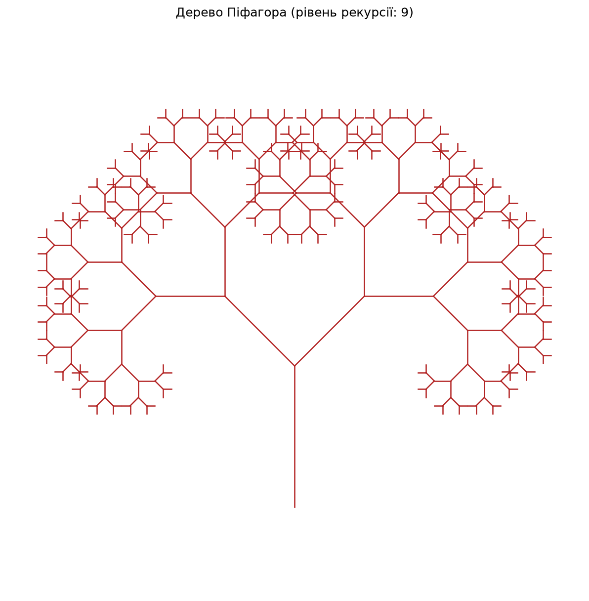
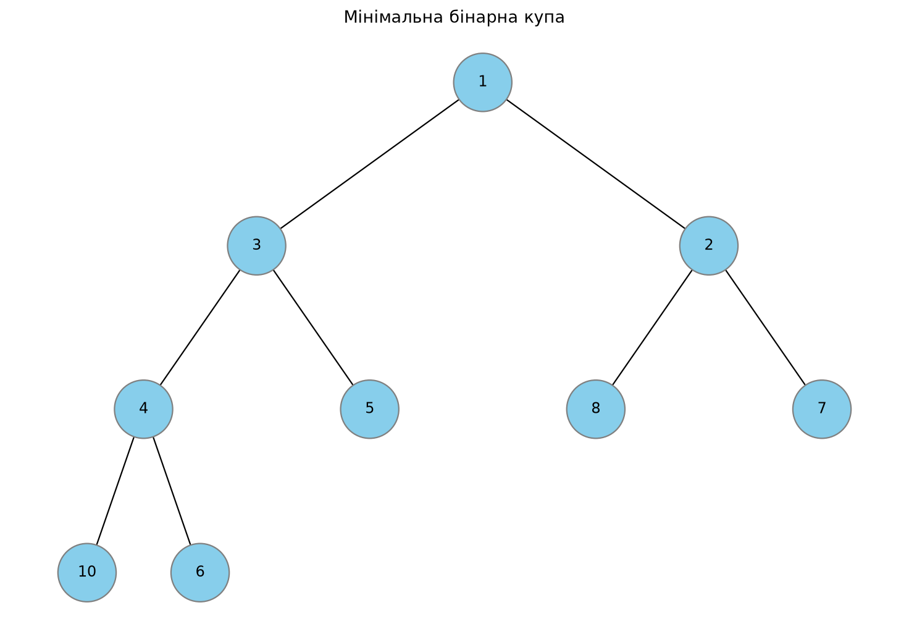
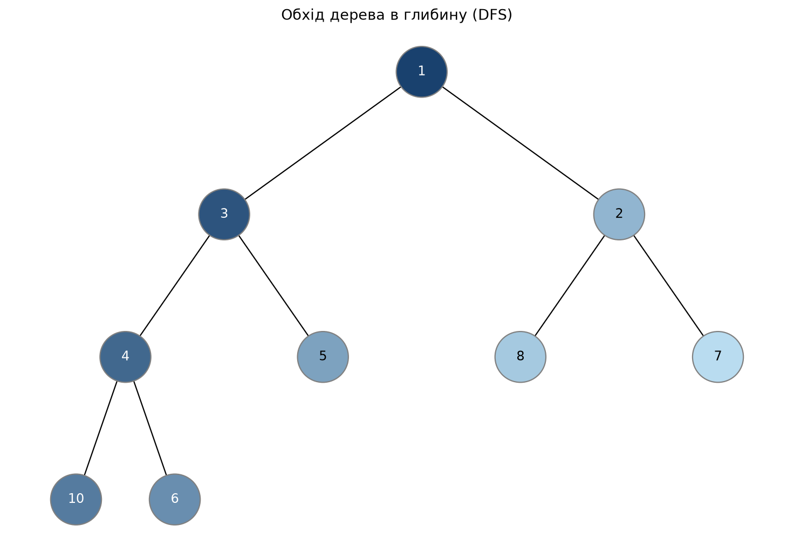
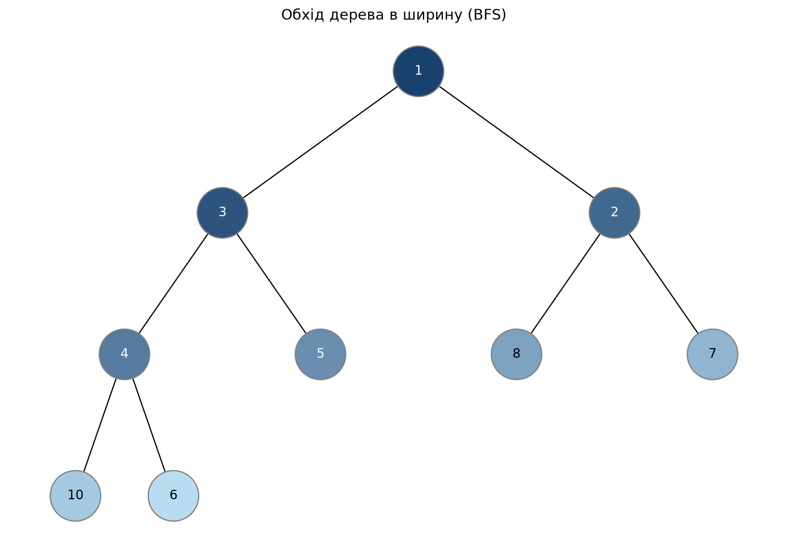
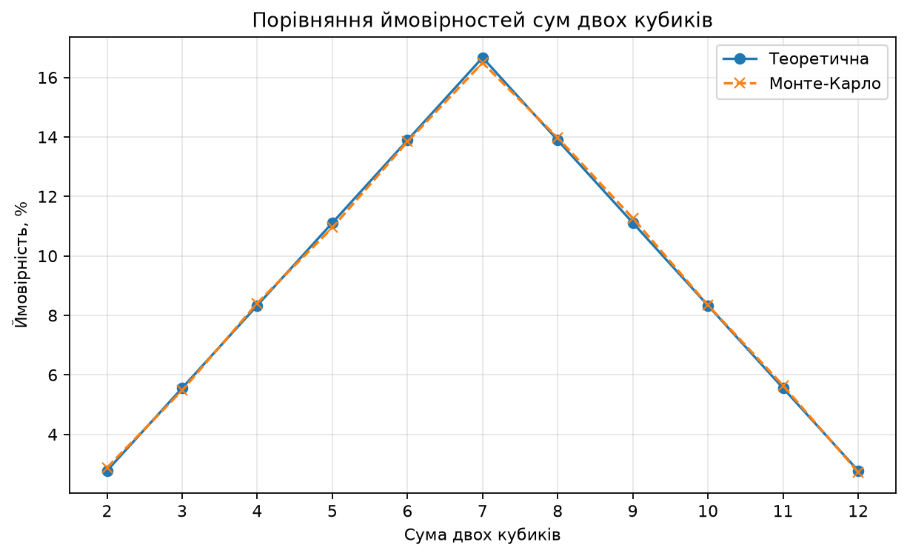

# Фінальний проєкт.

Курсу **Basic Algorithms and Data Structures 2.0**

Репозиторій `goit-algo-fp` містить сім завдань фінального проєкту.

## Завдання 1. Робота з однозв'язним списком

Реалізовано клас `LinkedList` та основні операції над однозв'язним списком:

- `reverse()` - реверсування списку шляхом зміни посилань між вузлами.
- `sort_insertion()` - сортування методом вставок.
- `sort_merge()` - сортування методом злиття.
- `merge_sorted_lists()` - об'єднання двох відсортованих списків в один.

Усі операції виконуються без перетворення однозв'язного списку на масив. Для відображення результатів використано бібліотеку `tabulate`.

### Реверсування та сортування

| Операція | Список |
|---|---|
| Початковий список | `7 -> 2 -> 9 -> 1 -> 5 -> 3` |
| Після реверсування | `3 -> 5 -> 1 -> 9 -> 2 -> 7` |
| Після сортування методом вставок | `1 -> 2 -> 3 -> 5 -> 7 -> 9` |
| Після реверсування | `9 -> 7 -> 5 -> 3 -> 2 -> 1` |
| Після сортування методом злиття | `1 -> 2 -> 3 -> 5 -> 7 -> 9` |

### Об'єднання відсортованих списків

| Операція | Список |
|---|---|
| Перший список | `1 -> 4 -> 7` |
| Другий список | `2 -> 3 -> 8` |
| Об'єднаний список | `1 -> 2 -> 3 -> 4 -> 7 -> 8` |


## Завдання 2. Рекурсія. Дерево Піфагора

Реалізовано рекурсивне побудування фрактального дерева.
Користувач може самостійно вибрати рівень рекурсії.

### Результат




## Завдання 3. Алгоритм Дейкстри з використанням бінарної купи

Реалізовано алгоритм Дейкстри для пошуку найкоротших шляхів від початкової вершини до всіх інших вершин зваженого графа.

Для вибору вершини з найменшою поточною відстанню використано дві реалізації мінімальної бінарної купи:

- `MinHeap` - власна реалізація у файлі `min_heap.py`.
- `StandardHeap` - реалізація на основі стандартного модуля `heapq`.

Функція `dijkstra()` підтримує обидві реалізації купи. Результати обчислень перевіряються на збіг за допомогою `assert`.

Функція `restore_path()` відновлює послідовність вершин найкоротшого шляху. Для виведення результатів використано бібліотеку `tabulate`.

### Результати

Початкова вершина: `A`.

| Вершина | Найкоротший шлях | Відстань |
|---|---|---:|
| A | A | 0 |
| B | A -> B | 5 |
| C | A -> C | 10 |
| D | A -> B -> D | 8 |
| E | A -> B -> D -> E | 12 |

Обидві реалізації купи дали однакові результати обчислення найкоротших відстаней.


## Завдання 4. Візуалізація бінарної купи

Реалізовано перетворення списку в мінімальну бінарну купу
та її візуалізацію за допомогою NetworkX і Matplotlib.




## Завдання 5. Візуалізація обходу бінарного дерева

Реалізовано два алгоритми обходу бінарного дерева, побудованого на основі коду із завдання 4:

- **DFS (Depth-First Search)** - обхід у глибину з використанням стека.
- **BFS (Breadth-First Search)** - обхід у ширину з використанням черги `deque`.

Обидва алгоритми реалізовано без рекурсії.

Під час обходу кожному вузлу присвоюється унікальний колір у форматі HEX RGB. Кольори змінюються від темних до світлих відповідно до порядку відвідування вузлів.

### Порядок відвідування вузлів

| Крок | DFS | BFS |
|-----:|----:|----:|
| 1 | 1 | 1 |
| 2 | 3 | 3 |
| 3 | 4 | 2 |
| 4 | 10 | 4 |
| 5 | 6 | 5 |
| 6 | 5 | 8 |
| 7 | 2 | 7 |
| 8 | 8 | 10 |
| 9 | 7 | 6 |

### Обхід у глибину (DFS)



### Обхід у ширину (BFS)




## Завдання 6. Жадібні алгоритми та динамічне програмування

Реалізовано два алгоритми вибору страв із максимальною сумарною калорійністю в межах заданого бюджету:

- **Жадібний алгоритм (`greedy_algorithm`)** - вибирає страви за спаданням співвідношення калорійності до вартості.
- **Динамічне програмування (`dynamic_programming`)** - знаходить оптимальну комбінацію страв за допомогою задачі про рюкзак.

### Результати для бюджету 100

| Алгоритм | Обрані страви | Вартість | Калорійність |
|---|---|---:|---:|
| Жадібний алгоритм | cola, potato, pepsi, hot-dog | 80 | 870 |
| Динамічне програмування | pizza, pepsi, cola, potato | 100 | 970 |

### Висновок

Жадібний алгоритм вибрав страви із сумарною калорійністю 870, використавши 80 одиниць бюджету.

Алгоритм динамічного програмування знайшов оптимальну комбінацію із сумарною калорійністю 970 при бюджеті 100.

Отже, для бюджету 100, динамічне програмування забезпечило на 100 калорій більше, оскільки враховує різні комбінації страв, тоді як жадібний алгоритм приймає рішення на основі локально найвигіднішого співвідношення калорійності до вартості.


## Завдання 7. Використання методу Монте-Карло

Реалізовано моделювання 100 000 кидків двох шестигранних кубиків методом Монте-Карло.

Програма обчислює суму значень обох кубиків для кожного кидка, підраховує частоту появи кожної можливої суми (від 2 до 12) та визначає її експериментальну ймовірність.

Теоретичні ймовірності обчислюються програмно за формулами:

$N(s) = 6 - |7 - s|$

$P(s) = \frac{N(s)}{36}$

де:
- $s$ - сума значень двох кубиків;
- $N(s)$ - кількість комбінацій для отримання суми;
- 36 - загальна кількість рівноймовірних комбінацій.

### Результати моделювання

| Сума | Теоретична | Монте-Карло | Відхилення, в.п. |
|---:|---:|---:|---:|
| 2 | 2.78% | 2.79% | 0.01 |
| 3 | 5.56% | 5.56% | 0.00 |
| 4 | 8.33% | 8.37% | 0.04 |
| 5 | 11.11% | 10.98% | 0.13 |
| 6 | 13.89% | 14.02% | 0.14 |
| 7 | 16.67% | 16.57% | 0.09 |
| 8 | 13.89% | 14.16% | 0.28 |
| 9 | 11.11% | 11.03% | 0.08 |
| 10 | 8.33% | 8.28% | 0.06 |
| 11 | 5.56% | 5.42% | 0.13 |
| 12 | 2.78% | 2.81% | 0.03 |

### Графік порівняння ймовірностей



### Висновки

За результатами 100 000 симуляцій експериментальні ймовірності виявилися близькими до теоретичних значень.

Найбільше відхилення становило 0.28 відсоткового пункта для суми 8. Найвищу ймовірність має сума 7, а найнижчу - суми 2 та 12.


## Запуск

Для виконання завдань потрібен Python 3.10 або новіший.

Встановлення залежностей із каталогу проєкту:

```powershell
python -m pip install -r requirements.txt
```

Запуск окремих завдань:

```powershell
python hw01.py
python hw02.py
python hw03.py
python hw04.py
python hw05.py
python hw06.py
python hw07.py
```

У завданні 2 програма запитує рівень рекурсії. Зображення, створені в завданнях 2, 4, 5 та 7, автоматично зберігаються в каталозі `assets/`.

## Файли проєкту

- `hw01.py` - однозв'язний список, реверсування та сортування.
- `hw02.py` - фрактальне дерево Піфагора.
- `hw03.py` - алгоритм Дейкстри.
- `hw04.py` - візуалізація бінарної купи.
- `hw05.py` - візуалізація DFS і BFS.
- `hw06.py` - жадібний алгоритм і динамічне програмування.
- `hw07.py` - метод Монте-Карло для двох кубиків.
- `min_heap.py` - власна реалізація мінімальної купи.
- `utils.py` - допоміжна функція збереження зображень у `assets/`.
- `requirements.txt` - зовнішні залежності проєкту.
- `assets/` - зображення результатів візуалізації.
